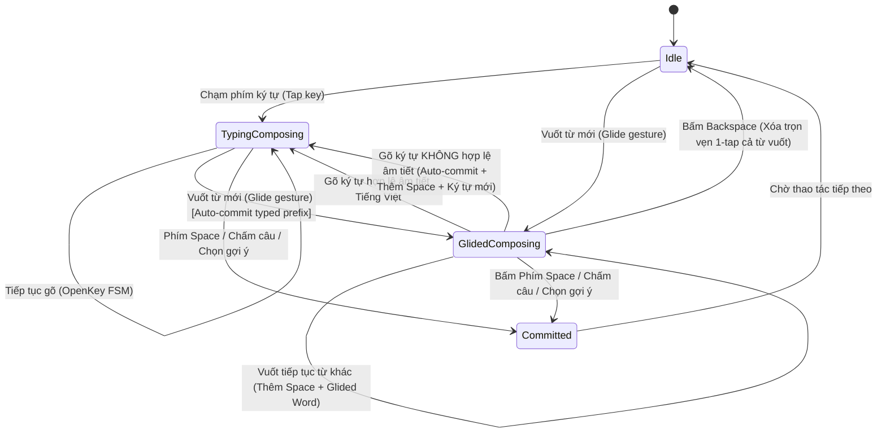

# ĐẶC TẢ KIẾN TRÚC VUỐT (GLIDE), TRẠNG THÁI SOẠN THẢO (COMPOSING) & HỆ THỐNG GỢI Ý TỪ THÔNG MINH

> **Tài liệu tham chiếu kỹ thuật cho vBoard iOS Keyboard**  
> *Phiên bản: 2.1 - Tiêu chuẩn tương thích trải nghiệm Gboard Tiếng Việt*

---

## 1. TỔNG QUAN VÀ BỐI CẢNH VẤN ĐỀ

Trong các phiên bản bàn phím tiếng Việt trước đây trên iOS, tính năng gõ lướt/vuốt (Glide Typing) và gợi ý từ tiếp theo thường xuyên gặp phải các lỗi nghiêm trọng làm suy giảm trải nghiệm người dùng:

1. **Thảm họa "Sửa dấu & Bóc tách âm tiết hậu kỳ"**:
   - Khi một từ được vuốt xong (ví dụ: `người`), nếu tiếp tục gõ thêm ký tự hoặc vuốt từ tiếp theo, bộ phân tích ngữ âm OpenKey FSM hiểu nhầm từ vừa chèn là văn bản thô chưa hoàn tất. Khi người dùng gõ thêm phụ âm hoặc nguyên âm, FSM cố gắng đảo dấu, lùi con trỏ hoặc xóa ngược (`deleteBackward`) làm nuốt mất từ vừa vuốt.
2. **Hiện tượng xóa mất chữ khi chuyển đổi Gõ thường $\rightarrow$ Vuốt (Typed-to-Glide Transition)**:
   - Khi người dùng đang gõ dở một từ (ví dụ gõ phím `v` và `i` $\rightarrow$ `vi`) nhưng chưa nhấn phím Space, sau đó quyết định vuốt tiếp từ kế tiếp, cơ chế cũ xóa trắng toàn bộ chuỗi đang soạn để nhường chỗ cho từ vuốt, làm mất chữ người dùng vừa nhập.
3. **Mất liên tục gợi ý N-gram sau khi vuốt**:
   - Sau khi vuốt thành công, bàn phím không tự động kích hoạt tính năng dự đoán từ tiếp theo (Next-word Prediction) dựa trên ngữ cảnh 2-gram hoặc 3-gram.
4. **Không có cơ chế học từ vựng cá nhân hóa theo thời gian thực**:
   - Từ mới của người dùng không được tự động học nếu xuất hiện thường xuyên, hoặc không có giao diện trực quan hóa để theo dõi bảng điểm xếp hạng Unigram, Bigram, Trigram.

Tài liệu này đặc tả toàn diện giải pháp kiến trúc: **Máy trạng thái Soạn thảo (Composing FSM)**, **Xác thực 2 tầng Tiếng Việt OpenKey**, **Công thức suy diễn N-gram Stupid Backoff kết hợp Personal Weighting**, và **Bộ khám phá Điểm số Từ điển (Dictionary Scores Explorer)**.

---

## 2. KIẾN TRÚC MÁY TRẠNG THÁI: SOẠN THẢO (COMPOSING) VS. ĐÃ CHỐT (COMMITTED)

Nhằm mô phỏng chính xác hành vi của Gboard và bảo vệ toàn vẹn dữ liệu nhập liệu, vBoard phân tách luồng nhập liệu thành 2 trạng thái rõ rệt:



### 2.1. Biến cờ Trạng thái (`KeyboardViewController.swift`)
- `isGlidedComposing: Bool`: Đánh dấu từ hiện tại trên văn bản vừa được tạo ra từ thao tác vuốt (Glide).
- `glidedComposingWord: String`: Nội dung từ vừa vuốt.
- `glidedPrefixSpaceCount: Int`: Số lượng dấu cách tự động chèn trước từ vuốt (để xử lý xóa hoàn nguyên nguyên tử khi người dùng bấm Backspace).

### 2.2. Chi tiết Hành vi Phản hồi Tương tác

| Tương tác kế tiếp | Trạng thái trước | Hành vi xử lý chi tiết (Gboard Standard) | Kết quả hiển thị |
| :--- | :--- | :--- | :--- |
| **Bấm phím Backspace** | `isGlidedComposing = true` | Xóa lùi nguyên tử toàn bộ độ dài `glidedComposingWord.count + glidedPrefixSpaceCount`. Reset trạng thái về `Idle`. | Hoàn nguyên y nguyên hiện trạng trước khi vuốt. |
| **Gõ ký tự tiếp theo** | `isGlidedComposing = true` | Chạy bộ kiểm tra chính tả 2 tầng với `glidedComposingWord + char`: <br>1. **Nếu hợp lệ âm tiết**: Cho phép nối tiếp vào từ đang soạn, reset `isGlidedComposing = false`, OpenKey tiếp tục xử lý dấu.<br>2. **Nếu vi phạm âm tiết**: Tự động Commit từ vừa vuốt, chèn 1 dấu cách, chuyển ký tự mới thành đầu từ soạn thảo mới. | Không nuốt từ, không làm hỏng cấu trúc ngữ âm tiếng Việt. |
| **Vuốt tiếp từ khác** | `isGlidedComposing = true` | Commit từ vuốt trước, chèn 1 dấu cách tự động (`insertText(" ")`), chèn từ vuốt mới và giữ cờ `isGlidedComposing = true`. | Các từ vuốt liên tục cách nhau 1 khoảng trắng tự nhiên. |
| **Gõ dấu chấm / phẩy** | `isGlidedComposing = true` | Commit từ vuốt ngay lập tức, triệt tiêu mọi khoảng trắng dư thừa, chèn dấu ngắt câu sát mép từ, kích hoạt dự đoán từ tiếp theo. | Văn bản sạch sẽ, đúng quy tắc văn phong tiếng Việt. |
| **Bấm phím Space** | `isGlidedComposing = true` | Commit từ vuốt thành công, chèn dấu cách, reset cờ `isGlidedComposing = false`, đẩy từ vào Lịch sử Ngữ cảnh (Context History) và tính toán N-gram. | Chuyển sang chế độ gợi ý từ tiếp theo. |

---

## 3. CHUYỂN ĐỔI GÕ THƯỜNG SANG VUỐT (TYPED-TO-GLIDE TRANSITION)

### 3.1. Vấn đề thực tế
Người dùng thường có thói quen gõ vài phím đầu tiên (ví dụ gõ `ng` hoặc `vie`) rồi chuyển sang vuốt từ tiếp theo mà chưa nhấn dấu cách. Nếu xóa từ `vi` đi, người dùng sẽ bị mất chữ.

### 3.2. Cơ chế Giải quyết Tự động (Prefix Auto-completion & Preservation)
Trong hàm `didGlideWord(_ word: String)` của `KeyboardViewController`:
1. Kiểm tra bộ đệm OpenKey `currentWord`:
   - Nếu `currentWord` đang có nội dung (ví dụ `vi`):
   - Truy vấn cây từ điển `WordTrie.shared.suggest(prefix: currentWord)` để tìm từ tối ưu nhất, hoặc giữ nguyên nếu đã là từ hoàn chỉnh.
   - Gọi `openKeyAdapter.finishComposing()` để chốt dứt điểm âm tiết đang gõ dở vào trường văn bản `UITextDocumentProxy`.
   - Chèn thêm một khoảng trắng (`" "`) để ngăn cách từ vừa gõ với từ chuẩn bị vuốt.
2. Chèn từ vừa vuốt (`insertText(word)`), bật cờ `isGlidedComposing = true`.
3. Cập nhật thanh gợi ý (Suggestion Bar) bằng xác suất Bigram dựa trên cặp `[từ vừa gõ dở, từ vừa vuốt]`.

---

## 4. XÁC THỰC ÂM TIẾT TIẾNG VIỆT 2 TẦNG (TWO-TIER VALIDATION)

Để phân định chính xác khi nào một ký tự gõ tiếp theo thuộc về từ đang soạn hay bắt đầu từ mới, hệ thống áp dụng cơ chế xác thực kép:

```
                  ┌─────────────────────────────────────┐
                  │ Chuỗi kết hợp: [Word] + [NextChar]  │
                  └──────────────────┬──────────────────┘
                                     │
                                     ▼
             ┌───────────────────────────────────────────────┐
             │ Tầng 1: OpenKey FSM Syllable Validation        │
             │ OpenKeyEngineAdapter.isValidVietnameseSpelling│
             └───────────────────────┬───────────────────────┘
                                     │
                    [Hợp lệ theo bộ luật ngữ âm?]
                                     │
                    ├─────────────── NO ───────────────┐
                    │ YES                              ▼
                    ▼                   ┌──────────────────────────────┐
     ┌──────────────────────────────┐   │ Vi phạm âm học:              │
     │ Tầng 2: WordTrie Dictionary  │   │ - Commit từ đang soạn        │
     │ WordTrie.isValidSyllable     │   │ - Tự động chèn Space (" ")   │
     └──────────────┬───────────────┘   │ - Ký tự mới bắt đầu từ mới   │
                    │                   └──────────────────────────────┘
          [Tồn tại trong từ điển?]
                    │
         ┌──────────┴──────────┐
         │ YES                 │ NO
         ▼                     ▼
┌──────────────────┐  ┌───────────────────────────────────┐
│ Nối tiếp âm tiết │  │ Kiểm tra hậu tố phụ âm hợp lệ    │
│ (Cho phép gõ dấu)│  │ (nh, ng, ch, c, p, t, m, n...)   │
└──────────────────┘  └───────────────────────────────────┘
```

1. **Tầng 1 - Luật Ngữ âm OpenKey FSM (`isValidVietnameseSpelling`)**:
   - Sử dụng hàm kiểm tra chuẩn âm của engine OpenKey C++ (`OpenKeyEngine.checkSpelling(forceCheckVowel: true)`).
   - Ngăn chặn ngay lập tức các tổ hợp phi tiếng Việt như `ngườis`, `đẹpx`, `họcw`.
2. **Tầng 2 - Thẩm định Từ vựng Thực nghiệm (`WordTrie.isValidVietnameseSyllable`)**:
   - Tra cứu nhanh qua cây tiền tố Trie với độ phức tạp $O(L)$ ($L$ là độ dài từ $\le 7$ ký tự).
   - Đảm bảo từ được ghép là một âm tiết có nghĩa thực tế trong kho ngữ liệu tiếng Việt.

---

## 5. MÔ HÌNH TOÁN HỌC DỰ ĐOÁN N-GRAM & STUPID BACKOFF

Hệ thống gợi ý từ tiếp theo của vBoard sử dụng mô hình N-gram kết hợp thuật toán **Stupid Backoff** (Brants et al.) cùng trọng số học máy cá nhân hóa (Personal Adaptive Weighting).

### 5.1. Công thức Xếp hạng Điểm số (Scoring Formula)

Điểm số dự đoán xác suất xuất hiện của từ tiếp theo $w_i$ dựa trên ngữ cảnh lịch sử 2 từ trước đó $(w_{i-2}, w_{i-1})$:

$$S(w_i \mid w_{i-2}, w_{i-1}) = \begin{cases} 
\frac{\text{Count}(w_{i-2}, w_{i-1}, w_i)}{\text{Count}(w_{i-2}, w_{i-1})} \times \alpha_{\text{personal}} & \text{nếu } (w_{i-2}, w_{i-1}, w_i) \in \text{Trigram} \\
\beta \times \frac{\text{Count}(w_{i-1}, w_i)}{\text{Count}(w_{i-1})} \times \alpha_{\text{personal}} & \text{nếu } (w_{i-1}, w_i) \in \text{Bigram} \\
\beta^2 \times \frac{\text{Count}(w_i)}{N} \times \alpha_{\text{personal}} & \text{Backoff về Unigram}
\end{cases}$$

Trong đó:
- $\beta = 0.4$: Hệ số phạt Backoff tiêu chuẩn (Backoff penalty discount).
- $\alpha_{\text{personal}} = 2.5$: Hệ số ưu tiên khuếch đại nếu từ $w_i$ nằm trong kho từ điển người dùng tự học (`UserAdaptiveLearningStore`).
- $N$: Tổng số lượng tần suất Unigram trong toàn bộ từ điển.

### 5.2. Nguyên tắc Học thích nghi Người dùng (User Adaptive Learning)
- **Quy tắc Thăng cấp (Promotion Rule)**: Một từ mới chỉ được thăng hạng từ bộ đệm tạm thời (Staging Buffer) lên Từ điển Cá nhân chính thức (Learned Words) nếu xuất hiện **$\ge 2$ lần trong vòng 24 giờ**.
- **Cơ chế Lọc rác**: Tự động loại bỏ các từ sai chính tả ngẫu nhiên, mật khẩu hoặc số thẻ nhập nhầm.

---

## 6. GIAO DIỆN KHÁM PHÁ BẢNG ĐIỂM TỪ ĐIỂN (DICTIONARY SCORES EXPLORER)

Nhằm phục vụ công tác kiểm thử, đối chiếu dữ liệu ngữ liệu và minh bạch hóa điểm số gợi ý, ứng dụng chính (Host App) cung cấp màn hình **Dictionary Scores Explorer** gồm 4 tab chuyên sâu:

```
┌─────────────────────────────────────────────────────────────┐
│                 BẢNG ĐIỂM TỪ ĐIỂN N-GRAM                    │
├──────────────┬──────────────┬──────────────┬────────────────┤
│ 1. Tự học    │ 2. Đơn (1)   │ 3. Cặp (2)   │ 4. Bộ ba (3)   │
├──────────────┴──────────────┴──────────────┴────────────────┤
│ 🔍 Tìm kiếm từ / cụm từ ngữ cảnh...                         │
├─────────────────────────────────────────────────────────────┤
│ [Từ vựng / Cụm N-gram]                [Tần suất / Điểm số] │
│ • việt nam                              Điểm: 1,842,910     │
│ • cộng hòa                              Điểm: 1,204,550     │
│ • người dùng                            Điểm: 984,120       │
│ • xin chào                              Điểm: 752,300       │
└─────────────────────────────────────────────────────────────┘
```

1. **Tab Tự học (Learned Words & Staging)**:
   - Danh sách từ người dùng đã được thăng hạng chính thức kèm điểm tần suất sử dụng thực tế.
   - Danh sách bộ đệm đếm số lần xuất hiện và thời gian hết hạn 24 giờ.
2. **Tab 1 chữ (Unigrams)**:
   - Tra cứu cây từ điển gốc > 15.000 từ vựng đơn kèm điểm tần suất chuẩn hóa.
3. **Tab 2 chữ (Bigrams)**:
   - Liệt kê các cặp từ đi liền nhau được sắp xếp giảm dần theo điểm số xác suất xuất hiện.
4. **Tab 3 chữ (Trigrams)**:
   - Liệt kê các cụm 3 từ mang tính ngữ cảnh cao, phục vụ gợi ý chính xác khi soạn thảo văn bản dài.

---

## 7. ĐỐI SOÁT KIỂM THỬ VÀ CHỨNG THỰC CHẤT LƯỢNG

Toàn bộ kiến trúc và các trường hợp biên (Edge Cases) được bảo đảm bằng bộ kiểm thử tự động toàn diện trong `Tests/vBoardEngineTests/IntelligentEngineTests.swift` gồm 7 test suites, 91 unit test cases:

- `testOneTapGlidedWordDeletion`: Kiểm tra xóa 1-chạm hoàn nguyên từ vuốt và khoảng trắng đi kèm.
- `testPunctuationDirectCommit`: Kiểm tra triệt tiêu dấu cách dư thừa khi gõ dấu câu ngay sau khi vuốt.
- `testConsecutiveGlidesWithAutoSpacing`: Kiểm tra vuốt liên tục nhiều từ tự động có dấu cách chuẩn mực.
- `testSpellingAndSyllableValidation`: Kiểm tra xác thực 2 tầng đối với các âm tiết tiếng Việt hợp lệ và bất hợp lệ.
- `testStupidBackoffMath`: Kiểm tra tính toán phân tầng điểm số Stupid Backoff với $\beta = 0.4$ và $\alpha = 2.5$.
- `testAdaptiveLearningWindow`: Kiểm tra quy tắc $\ge 2$ lần trong 24 giờ của `UserAdaptiveLearningStore`.
- `testTypedToGlideTransition`: Kiểm tra giữ nguyên từ đang gõ dở khi chuyển sang cử chỉ vuốt.

---

## 8. TÀI LIỆU VÀ MÃ NGUỒN LIÊN QUAN

- [KeyboardViewController.swift](file:///Users/nguyenphuong/Projects/phuong/ios/vBoard/Sources/vBoardKeyboard/KeyboardViewController.swift) - Bộ điều khiển chính bàn phím và Máy trạng thái Composing.
- [OpenKeyEngineAdapter.swift](file:///Users/nguyenphuong/Projects/phuong/ios/vBoard/Sources/vBoardEngine/OpenKey/OpenKeyEngineAdapter.swift) - Cầu nối kiểm tra ngữ âm FSM OpenKey.
- [WordTrie.swift](file:///Users/nguyenphuong/Projects/phuong/ios/vBoard/Sources/vBoardEngine/Dictionary/WordTrie.swift) - Cây tiền tố từ điển và tra cứu âm tiết thực nghiệm.
- [NextWordPredictor.swift](file:///Users/nguyenphuong/Projects/phuong/ios/vBoard/Sources/vBoardEngine/Dictionary/NextWordPredictor.swift) - Bộ suy diễn Stupid Backoff N-gram.
- [UserAdaptiveLearningStore.swift](file:///Users/nguyenphuong/Projects/phuong/ios/vBoard/Sources/vBoardEngine/Dictionary/UserAdaptiveLearningStore.swift) - Bộ lưu trữ thích ứng từ vựng cá nhân.
- [vBoardApp.swift](file:///Users/nguyenphuong/Projects/phuong/ios/vBoard/HostApp/vBoardApp.swift) - Màn hình Khám phá Bảng điểm Từ điển (Host App).
- [IntelligentEngineTests.swift](file:///Users/nguyenphuong/Projects/phuong/ios/vBoard/Tests/vBoardEngineTests/IntelligentEngineTests.swift) - Toàn bộ kiểm thử tự động của hệ thống gợi ý.
